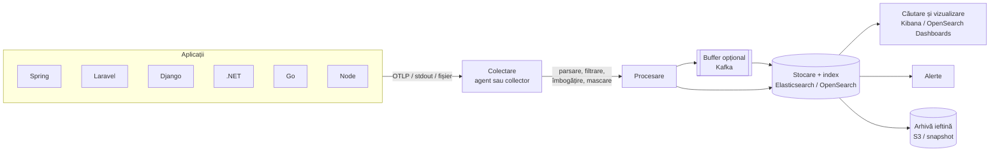
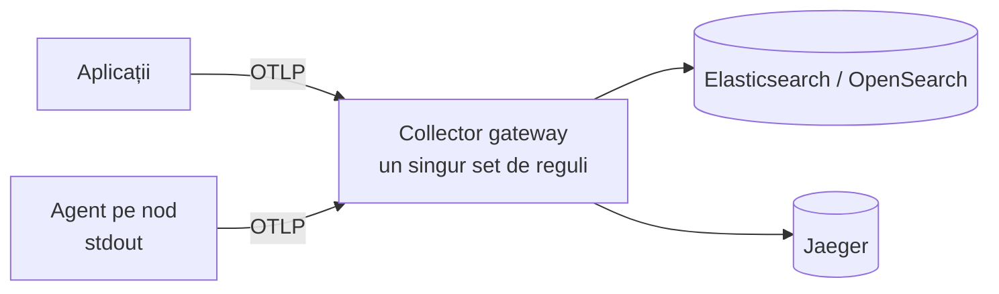
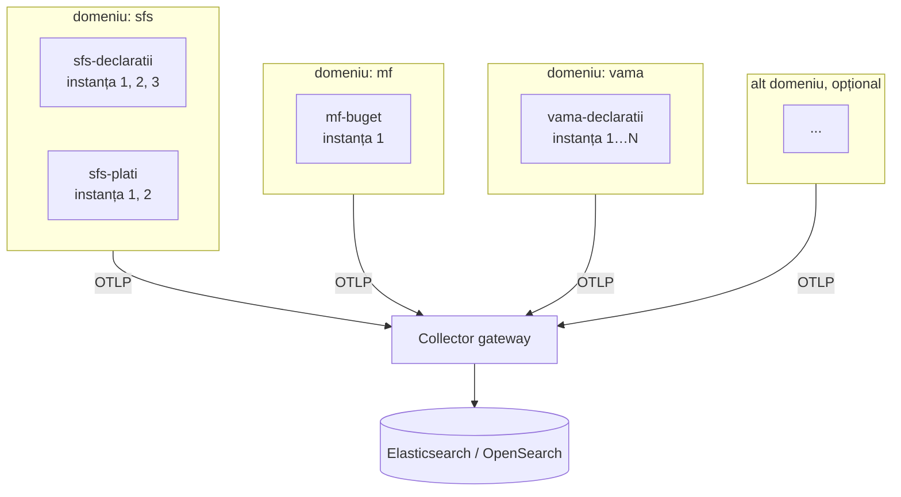

# 2. Centralizarea logurilor

<!-- cuprins -->
**Cuprins**

- [2.1 Problema: de ce nu ajung logurile locale](#21-problema-de-ce-nu-ajung-logurile-locale)
- [2.2 Ce înseamnă centralizare](#22-ce-înseamnă-centralizare)
- [2.3 Arhitectura de referință](#23-arhitectura-de-referință)
- [2.4 Modele de colectare](#24-modele-de-colectare)
- [2.5 Normalizarea: un standard pentru toate serviciile](#25-normalizarea-un-standard-pentru-toate-serviciile)
- [2.6 Corelarea](#26-corelarea)
- [2.7 Securitate și date personale (GDPR)](#27-securitate-și-date-personale-gdpr)
- [2.8 Retenție și costuri](#28-retenție-și-costuri)
- [2.9 Fiabilitate](#29-fiabilitate)
- [2.10 Alertare și utilizare](#210-alertare-și-utilizare)
- [2.11 Pași de implementare (checklist)](#211-pași-de-implementare-checklist)
- [2.12 Anti-pattern-uri](#212-anti-pattern-uri)
- [2.13 Mai multe domenii și instanțe (SFS, MF, CTIF, Vamă, …)](#213-mai-multe-domenii-și-instanțe-sfs-mf-ctif-vamă-)
- [2.14 În proiect](#214-în-proiect)
<!-- /cuprins -->

## 2.1 Problema: de ce nu ajung logurile locale

Pe un singur server, `tail -f app.log` ajunge. Într-un sistem distribuit, nu:

| Problemă | Exemplu |
|----------|---------|
| **multe servicii, multe instanțe** | o cerere trece prin 6 servicii (Node → Go → Django → .NET → Laravel → Spring), fiecare cu fișierul lui, pe altă mașină sau în alt container |
| **containerele sunt efemere** | când un pod Kubernetes moare sau e mutat, logurile lui locale dispar |
| **corelarea** | ca să înțelegi o eroare trebuie logurile tuturor serviciilor din *aceeași* cerere, ordonate în timp |
| **căutarea** | „toate erorile 5xx ale utilizatorului X de ieri" nu se face cu `grep` pe 40 de mașini |
| **formate diferite** | Java scrie `INFO`, .NET `Information`, PHP `info`; fiecare cu alte câmpuri |
| **retenția și auditul** | cerințe legale / de securitate: păstrare N zile, acces controlat, imutabilitate |
| **alertarea** | „peste 50 de ERROR în 5 minute" are nevoie de toate logurile într-un loc |
| **accesul** | dezvoltatorii nu trebuie să aibă SSH în producție ca să citească loguri |
| **discul** | logurile locale umplu discul serverului și pot opri aplicația |

## 2.2 Ce înseamnă centralizare

**Centralizare** = toate logurile, de la toate serviciile și instanțele, ajung într-un singur sistem unde sunt
**colectate, normalizate, stocate, indexate, căutate, vizualizate, alertate și păstrate** după reguli comune.

Obiective:

1. **un singur loc** de căutare pentru toată organizația;
2. **un singur format** (aceleași chei, aceleași niveluri) indiferent de limbaj;
3. **corelare** după `trace_id` între servicii și cu trace-urile;
4. **siguranță**: fără secrete, acces pe roluri, transport criptat;
5. **cost controlat**: retenție pe niveluri, doar ce e util.

## 2.3 Arhitectura de referință



| Strat | Rol | Exemple |
|-------|-----|---------|
| Producere | aplicația scrie loguri **structurate** cu context | SDK OpenTelemetry, Logback, Monolog, slog, pino |
| Colectare | preia logurile de la aplicații / noduri | OpenTelemetry Collector, Filebeat, Fluent Bit, Elastic Agent, Vector |
| Procesare | parsează, normalizează, filtrează, maschează, rutează | Collector (processors / OTTL), Logstash, Data Prepper, ingest pipelines |
| Buffer (opțional) | absoarbe vârfurile, decuplează producătorii de stocare | Kafka, Redis Streams |
| Stocare | indexează pentru căutare rapidă, aplică retenția | Elasticsearch, OpenSearch, Loki, ClickHouse |
| Vizualizare și alerte | căutare, dashboard-uri, alerte | Kibana, OpenSearch Dashboards, Grafana |
| Arhivă | păstrare lungă, ieftină, pentru audit | snapshot-uri în S3 / MinIO |

## 2.4 Modele de colectare

### Agent pe nod (citește stdout / fișiere)

- în Kubernetes: un DaemonSet (Fluent Bit, Filebeat, OTel Collector cu `filelog`) citește logurile tuturor
  containerelor de pe nod din `/var/log/containers`;
- aplicația doar scrie pe **stdout** (principiul *12-factor*: logul e un flux de evenimente);
- **plus:** nu atingi codul aplicațiilor, prinde și aplicații vechi;
- **minus:** textul trebuie parsat; corelarea cu trace-urile depinde de ce scrie aplicația.

### Direct din aplicație (OTLP)

- SDK-ul OTel trimite înregistrări deja structurate, cu `trace_id` / `span_id` și resursa
  (serviciu, versiune, mediu) atașate automat;
- **plus:** fără parsare, corelare automată, același protocol pentru logs / traces / metrics;
- **minus:** dacă backend-ul cade, aplicația trebuie să bufereze (de aceea se pune un collector la mijloc).

### Gateway collector (recomandat, folosit în proiect)



Un collector central primește de la toate serviciile, aplică **aceleași reguli** (standardul, mascarea,
rutarea pe indexuri) și trimite mai departe. Schimbi backend-ul doar în configurarea collectorului.

### Push vs. pull

| | Push | Pull |
|---|------|------|
| cine inițiază | aplicația / agentul trimite | agentul citește (fișiere, API) |
| exemple | OTLP, syslog, HTTP | `filelog`, Filebeat pe fișiere |
| când | aplicații noi, instrumentate | aplicații existente, fișiere de sistem |

## 2.5 Normalizarea: un standard pentru toate serviciile

Centralizarea fără standard doar mută haosul într-un singur loc:

| Ce | Spring | .NET | Laravel | pino |
|----|--------|------|---------|------|
| nivel | `INFO` | `Information` | `info` | `30` / `info` |
| zgomot | `code.lineno`, MDC `trace_id` | `{OriginalFormat}`, `ConnectionId` | — | `pid`, `hostname` |

Standardul trebuie să fixeze:

| Regulă | Exemplu |
|--------|---------|
| **același set de chei** | `timestamp`, `level`, `logger`, `service`, `environment`, `message`, `trace_id`, `span_id`, `context`, `request`, `response`, `tags` |
| **aceleași niveluri** | log4j: `INFO`, `WARN`, `ERROR`, `FATAL` în stocarea centrală; `TRACE` / `DEBUG` **nu ajung acolo** |
| **timp în UTC, ISO 8601** | `2026-10-11T19:25:50.373470Z` |
| **identitatea sursei** | `service` = `<app>-otel-api`, `environment` = `local` / `prod` |
| **fără zgomot** | fără `host.*`, `process.*`, `code.*`, user agent, header-e |
| **fără secrete** | `password`, `token`, `secret`, `access_token` → `"******"` |
| **index `[app-name]-[data]`** | `spring-otel-api-2026.10.12`, `go-otel-api-2026.10.12`, … |

Standardul se impune **la sursă** (configurarea SDK-urilor, middleware) **și în collector** (plasă de
siguranță pentru orice serviciu nou). Formatul exact din proiect e în
[07-implementare-in-proiect.md](07-implementare-in-proiect.md).

## 2.6 Corelarea

Logurile centralizate devin utile când pot fi legate între ele și de trace-uri:

- fiecare log scris în timpul unei cereri are `trace_id` și `span_id`;
- Trace ID-ul se propagă între servicii (`traceparent`) și prin cozi — vezi
  [04-propagarea-trace-id.md](04-propagarea-trace-id.md);
- clientul primește `X-Trace-Id`, deci o eroare raportată se găsește direct:
  `trace_id:"4741e404…"` în Kibana arată logurile **tuturor** serviciilor pentru cererea respectivă.

## 2.7 Securitate și date personale (GDPR)

| Risc | Măsură |
|------|--------|
| parole / tokenuri în loguri | mascare la sursă **și** în collector, înainte de stocare |
| date personale (email, IP, CNP) | loghează doar ce e necesar; pseudonimizează (`userId` în loc de email); retenție limitată |
| interceptare pe drum | TLS între aplicații, collector și stocare |
| acces neautorizat | autentificare, roluri pe indexuri (cine vede `payments-api-*`), audit al accesului |
| modificarea logurilor | indexuri doar-adăugare (data streams), snapshot-uri, imutabilitate pentru audit |

## 2.8 Retenție și costuri

Logurile sunt de obicei **cel mai mare volum** de date de observabilitate.

| Fază | Durată tipică | Stocare |
|------|---------------|---------|
| hot | 1–7 zile | SSD, căutare rapidă |
| warm | 7–30 zile | disc mai ieftin, mai puține replici |
| cold / arhivă | luni – ani (audit) | snapshot în S3, căutare rară |
| delete | după politică | — |

Cum reduci costul:

- loghezi **ce folosești**: `DEBUG` / `TRACE` nu ajung niciodată în stocarea centrală (filtrate în collector), fără loguri pe fiecare iterație;
- un log de cerere (`request completed`) în loc de cinci;
- fără câmpuri redundante (durata și header-ele sunt deja în trace);
- corpuri limitate (≤ 4 KB) și doar JSON;
- retenție diferită pe index (`vama-*` 1 an pentru audit, aplicații interne 30 zile); cu index zilnic, retenția = ștergi zilele vechi;
- **eșantionare**: normală la trace-uri, rară la loguri (pierzi exact eroarea care contează).

## 2.9 Fiabilitate

- **batch + retry** în collector (`batch`, `retry_on_failure`, `sending_queue`): stocarea poate fi indisponibilă câteva minute fără să pierzi date;
- **backpressure**: `memory_limiter` în collector, ca un vârf să nu-l oprească;
- **buffer** (Kafka) la volume mari sau când stocarea e în altă regiune;
- **logul nu blochează aplicația**: exportul e asincron; dacă nu se poate trimite, se pierde logul, nu cererea;
- **monitorizează pipeline-ul**: rata de loguri pe serviciu; o scădere bruscă = colectare stricată.

## 2.10 Alertare și utilizare

| Alertă | Interogare (Kibana / KQL) |
|--------|---------------------------|
| erori pe serviciu | `level:ERROR and service:"go-otel-api"` > N în 5 min |
| erori de server | `response.statusCode >= 500` |
| posibil atac | `level:WARN and response.statusCode:401` în rafală de la același `context.ipAddress` |
| tăcere | 0 loguri de la un serviciu în 10 min |

Utilizare zilnică: Discover cu data view-ul `logs`, filtre pe `service`, `level`, `context.userId`,
`trace_id`; din log → Jaeger cu același `trace_id`.

## 2.11 Pași de implementare (checklist)

1. **Inventar**: ce servicii, ce limbaje, ce volum, ce cerințe de retenție și acces.
2. **Standardul**: scrie formatul (chei, niveluri, ce nu se loghează) înainte de cod.
3. **La sursă**: loguri structurate, SDK OTel / bridge-uri de log, middleware care pune contextul
   (`trace_id`, utilizator) și scrie un log per cerere.
4. **Collector**: receivers OTLP (+ `filelog` pentru aplicații vechi), processors de normalizare și mascare,
   exporter spre stocare; `batch`, `memory_limiter`, retry.
5. **Stocare**: Elasticsearch / OpenSearch cu index template (tipuri pentru câmpurile fixe), un index /
   data stream per aplicație, politică ILM / ISM — vezi [06-elk-opensearch.md](06-elk-opensearch.md).
6. **Acces**: TLS, utilizatori, roluri pe indexuri.
7. **Vizualizare**: data view, căutări salvate, dashboard-uri, alerte.
8. **Teste automate** pe format: fiecare serviciu produce exact cheile standardului, fără secrete.
9. **Documentare**: cum se caută, unde e formatul, cine e responsabil de pipeline.

## 2.12 Anti-pattern-uri

| Greșit | Corect |
|--------|--------|
| loguri text libere, parsate cu regex | loguri structurate JSON / OTLP |
| fiecare serviciu cu alt format și alte niveluri | un standard impus la sursă și în collector |
| aplicația scrie direct în Elasticsearch | aplicație → collector → stocare |
| `DEBUG` / `TRACE` trimise în Elasticsearch | doar `INFO`+ centralizat; `DEBUG` rămâne local (consolă), la dezvoltare |
| parole, tokenuri, carduri în loguri | mascare înainte de stocare |
| un index uriaș pentru tot, păstrat la nesfârșit | index per aplicație + retenție |
| mii de indexuri mici (unul pe zi pe serviciu mic) | data streams cu rollover pe mărime |
| traces, metrici și loguri amestecate în același index | fiecare semnal în backend-ul potrivit |
| id de corelare inventat în fiecare serviciu | `trace_id` W3C propagat |

## 2.13 Mai multe domenii și instanțe (SFS, MF, CTIF, Vamă, …)

Într-o organizație mare (de ex. un ecosistem de instituții: **SFS**, **MF**, **CTIF**, **Vamă** sau altele),
aceeași platformă de loguri primește date din **mai multe domenii**, fiecare cu **aplicațiile lui** și cu
**mai multe instanțe** ale fiecărei aplicații. Standardul trebuie să funcționeze pentru oricâte domenii, fără
ca vreunul să fie obligatoriu: un domeniu nou se adaugă doar prin configurare, unul care lipsește nu strică
nimic.

### Modelul: domeniu → aplicație → instanță



### Identitatea sursei: atribute de resursă

Fiecare instanță se identifică **o singură dată**, la pornire, prin resursa OTel (variabile de mediu,
fără cod):

| Atribut OTel | Cheie în log | Exemplu | Obligatoriu |
|--------------|--------------|---------|-------------|
| `service.namespace` | `domain` | `sfs`, `mf`, `ctif`, `vama` | nu — lipsește dacă există un singur domeniu |
| `service.name` | `service` | `sfs-declaratii-api` | **da** |
| `service.instance.id` | `instance` | `sfs-declaratii-7c9f-2` (pod / container / VM) | nu, dar recomandat când sunt mai multe instanțe |
| `service.version` | `version` | `2.4.1` | nu, util la deploy-uri |
| `deployment.environment.name` | `environment` | `prod`, `test`, `local` | **da** |

```bash
OTEL_SERVICE_NAME=sfs-declaratii-api
OTEL_RESOURCE_ATTRIBUTES=service.namespace=sfs,service.instance.id=$HOSTNAME,deployment.environment.name=prod
```

Reguli:

- în stocare ajung doar `INFO`, `WARN`, `ERROR`, `FATAL` — `DEBUG` / `TRACE` nu, pentru niciun domeniu;
- **obligatorii doar** `service`, `environment`, `timestamp`, `level`, `message`; restul cheilor apar
  **numai dacă au valoare** (fără `null`, fără `""`) — collectorul le omite automat;
- `domain` vine din resursă, **nu** din numele serviciului; un serviciu fără `service.namespace` merge
  într-un index / domeniu implicit (de ex. `shared`);
- `instance` diferențiază replicile: aceeași cerere apare cu același `trace_id`, dar pe instanța care a
  procesat-o — util când doar o instanță are o problemă (disc plin, versiune veche);
- nu se pune `host.*` / `process.*` complet — `instance` ajunge pentru identificare.

### Indexuri pe domeniu și aplicație

| Variantă | Nume | Când |
|----------|------|------|
| `[app-name]-[data]`, cu domeniul în numele aplicației | `sfs-declaratii-api-2026.10.12`, `vama-declaratii-api-2026.10.12` | **recomandat** — acces și retenție pe tiparul `sfs-*`, `vama-*` |
| `[domeniu]-[app-name]-[data]` din resursă | `sfs-declaratii-api-2026.10.12` (domeniul din `service.namespace`) | când numele serviciilor nu conțin domeniul |
| index comun + câmp `domain` | `logs-2026.10.12` | volum mic, același acces pentru toți |

În collector, rutarea e o singură regulă, cu valoare implicită pentru domeniul lipsă:

```yaml
# OTTL: [domeniu]-[service.name]-YYYY.MM.DD, sau [service.name]-YYYY.MM.DD fără domeniu
- set(log.attributes["elasticsearch.index"], Concat([resource.attributes["service.name"], FormatTime(log.time, "%Y.%m.%d")], "-")) where resource.attributes["service.namespace"] == nil
- set(log.attributes["elasticsearch.index"], Concat([resource.attributes["service.namespace"], resource.attributes["service.name"], FormatTime(log.time, "%Y.%m.%d")], "-")) where resource.attributes["service.namespace"] != nil
```

Index template-ul rămâne **unul singur** (tipare `sfs-*`, `mf-*`, `ctif-*`, `vama-*`, …), deci toate domeniile au același mapping, iar în
Kibana un singur data view (aceleași tipare) caută peste tot; filtrezi cu `domain:"vama"`.

### Acces, retenție și volum pe domeniu

| Ce | Cum |
|----|-----|
| **acces** | rol per domeniu pe tiparul de index (`sfs-*` doar pentru echipa SFS); Kibana *Spaces* / OpenSearch *tenants* per domeniu; o echipă centrală (operare, securitate) vede tot |
| **retenție** | politică ILM / ISM per domeniu (de ex. `vama` 1 an pentru audit, `mf` 90 zile) |
| **volum** | cote / alerte pe rata de loguri per domeniu, ca un domeniu zgomotos să nu-i afecteze pe ceilalți |
| **izolare** | la cerințe stricte: cluster separat per domeniu, același collector și același standard |
| **corelare între domenii** | `traceparent` se propagă și între domenii (de ex. Vamă → SFS); `trace_id` e același, deci o cerere se urmărește cap-coadă, chiar dacă fiecare echipă vede doar indexurile ei |

### Instanțe multiple: ce trebuie să știi

- **nu** scrie loguri în fișiere locale pe instanță ca sursă principală — instanțele apar și dispar
  (autoscaling, deploy); trimite OTLP sau stdout către collector;
- ordinea între instanțe se face după `timestamp` (ceasuri sincronizate cu NTP) și `trace_id` / `span_id`,
  nu după ordinea de sosire;
- un collector **agent** per nod / VM plus un **gateway** central scalează la oricâte instanțe;
  gateway-ul poate avea și el mai multe replici în spatele unui load balancer (fără stare);
- la deploy, `version` + `instance` arată imediat dacă erorile vin doar de la instanțele noi.

## 2.14 În proiect

- 6 servicii trimit OTLP la collectorul EDOT (`:4328`) — modelul **gateway collector**;
- collectorul aruncă `DEBUG` / `TRACE` (`filter/no-debug`), aplică standardul (`transform/standard`, `transform/log-format`) și scrie documentul plat în
  indexul zilnic `<service.name>-YYYY.MM.DD` (ex. `spring-otel-api-2026.10.12`); trace-urile merg în Jaeger, metricile sunt aruncate;
- `spring-otel/elk/kibana-setup.sh` creează index template-ul `app-logs` (tipare `*-otel-api-*`, `*-otel-worker-*`) și data view-ul `logs`;
- `./purge-all.sh` șterge datele; testele din `e2e/` verifică formatul pentru fiecare serviciu.

<!-- nav -->
---
[← 1. Ce este un log](01-logs.md) · [Cuprins](README.md) · [3. Logs, traces, metrics — cei trei piloni →](03-logs-traces-metrics.md)
<!-- /nav -->
