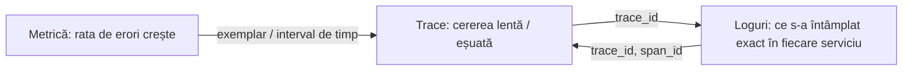

# 3. Logs, traces, metrics — cei trei piloni

<!-- cuprins -->
**Cuprins**

- [3.1 Logs](#31-logs)
- [3.2 Traces](#32-traces)
- [3.3 Metrics](#33-metrics)
- [3.4 Cum se leagă: corelarea](#34-cum-se-leagă-corelarea)
- [3.5 Context comun: baggage](#35-context-comun-baggage)
<!-- /cuprins -->

**Observabilitatea** = capacitatea de a înțelege ce se întâmplă într-un sistem doar din datele pe care le
emite. Datele vin în trei forme principale:

| | Logs | Traces | Metrics |
|---|------|--------|---------|
| Ce sunt | evenimente discrete | drumul unei cereri prin servicii | valori numerice agregate în timp |
| Întrebare | *Ce s-a întâmplat?* | *Pe unde a trecut și unde a fost lent / a eșuat?* | *Cât de des, cât de mult?* |
| Unitate | o înregistrare | un trace = arbore de span-uri | o serie temporală (nume + etichete) |
| Volum | mare (per eveniment) | mare (per cerere), se eșantionează | mic (agregat) |
| Detaliu | maxim pe un eveniment | structură și durate | statistic, fără detaliu individual |
| Bun pentru | depanare, audit, erori | latență, dependențe, unde e problema | alerte, tendințe, capacitate, SLO |
| În proiect | Elasticsearch (`<service.name>-YYYY.MM.DD`) | Jaeger | nu se stochează (collectorul le aruncă) |

## 3.1 Logs

Evenimente individuale cu timestamp, nivel, mesaj și câmpuri. Vezi [01-logs.md](01-logs.md).

## 3.2 Traces

Un **trace** reprezintă o cerere de la cap la coadă. E format din **span-uri**: fiecare span e o operație
(cererea HTTP primită, apelul la alt serviciu, o interogare SQL), cu început, durată, status și atribute.
Span-urile au părinte, deci formează un arbore:

```
trace 4741e404…  POST /api/todos                                    [laravel-otel-api]   120 ms
├─ RunTodoCascade (job)                                             [laravel-otel-worker] 95 ms
│  ├─ POST /api/cascade                                             [node-otel-api]       60 ms
│  │  ├─ POST /api/cascade                                          [go-otel-api]         32 ms
│  │  └─ POST /api/cascade                                          [django-otel-api]     41 ms
│  │     └─ POST /api/cascade                                       [spring-otel-api]     18 ms
│  └─ POST /api/cascade                                             [dotnet-otel-api]     25 ms
│     └─ POST /api/cascade                                          [spring-otel-api]     15 ms
```

- **trace_id** (16 octeți, 32 hex) — același pentru toate span-urile cererii, în toate serviciile;
- **span_id** (8 octeți, 16 hex) — al fiecărei operații;
- **span events** — momente din interiorul unui span (`exception`, `work.started`);
- **status** — `OK` / `ERROR`.

Trace-ul trece dintr-un serviciu în altul prin header-ul HTTP **`traceparent`** (W3C Trace Context):

```
traceparent: 00-4741e404d29f9a61884b88c4e99b99a6-45ff23706bc3c8c7-01
             ver  trace_id                          span părinte       eșantionat
```

## 3.3 Metrics

Numere agregate: contoare (`echo.requests` total), gauge-uri (memorie folosită acum), histograme
(distribuția duratei cererilor → p50/p95/p99). Sunt ieftine de stocat și ideale pentru alerte și grafice pe
termen lung („rata de erori > 1% timp de 5 minute"). Nu spun *care* cerere a eșuat — pentru asta ai logs și
traces.

## 3.4 Cum se leagă: corelarea

Puterea vine din legături:



1. O **metrică** arată că ceva e greșit (alertă).
2. Un **trace** arată unde (ce serviciu, ce operație).
3. **Logurile** cu același `trace_id` arată de ce (mesajul de eroare, datele cererii).

De aceea fiecare log scris în timpul unei cereri are `trace_id` și `span_id`. În proiect:
- `X-Trace-Id` în răspunsul HTTP → îl cauți în Jaeger (`http://localhost:16686/trace/<id>`);
- același id în Kibana: `trace_id:"<id>"` în data view-ul `logs` arată logurile tuturor serviciilor
  pentru acea cerere (inclusiv job-ul din coadă).

## 3.5 Context comun: baggage

Pe lângă `traceparent`, header-ul W3C **`baggage`** propagă perechi cheie-valoare prin toate serviciile
(`request.id`, `user.id`). Fiecare serviciu le pune pe span-uri și pe loguri — așa știi *cine* a făcut cererea
în orice serviciu, fără ca serviciul să primească direct JWT-ul.

<!-- nav -->
---
[← 2. Centralizarea logurilor](02-centralizare.md) · [Cuprins](README.md) · [4. Unde se propagă și se salvează Trace ID-ul →](04-propagarea-trace-id.md)
<!-- /nav -->
