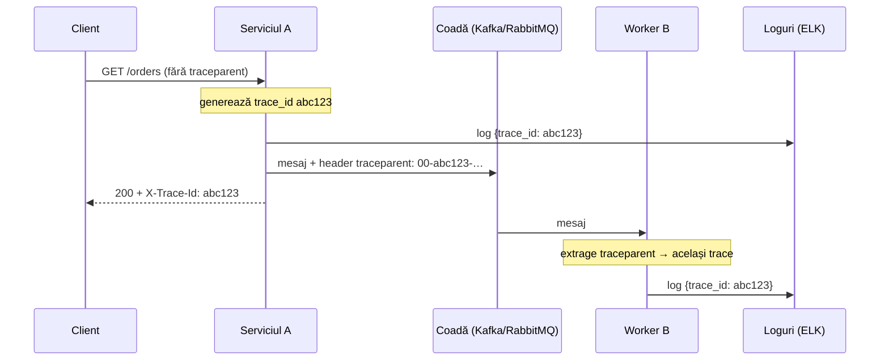

# 4. Unde se propagă și se salvează Trace ID-ul

<!-- cuprins -->
**Cuprins**

- [4.1 În header-ele HTTP / mesaje de rețea (propagarea contextului)](#41-în-header-ele-http--mesaje-de-rețea-propagarea-contextului)
- [4.2 În loguri (MDC / context de logare)](#42-în-loguri-mdc--context-de-logare)
- [4.3 În răspunsul HTTP către client (recomandat)](#43-în-răspunsul-http-către-client-recomandat)
- [4.4 În baza de date / audit log (unde e cazul)](#44-în-baza-de-date--audit-log-unde-e-cazul)
- [4.5 Cum circulă un Trace ID într-o cerere](#45-cum-circulă-un-trace-id-într-o-cerere)
- [4.6 Sfat practic](#46-sfat-practic)
<!-- /cuprins -->

Într-o arhitectură multi-stack / microservicii, Trace ID-ul trebuie să ajungă în **4 locuri**:

| # | Unde | De ce | Obligatoriu |
|---|------|-------|-------------|
| 1 | header-e HTTP / metadata mesajelor | serviciul următor continuă **același** trace | da |
| 2 | loguri (MDC / context de logare) | cauți toate logurile unei cereri după un id | da |
| 3 | răspunsul HTTP către client | utilizatorul / suportul are un cod de referință | recomandat |
| 4 | baza de date / audit log | legi o înregistrare din DB de trace și loguri | unde e cazul |

## 4.1 În header-ele HTTP / mesaje de rețea (propagarea contextului)

Când un serviciu apelează alt serviciu, Trace ID-ul merge prin rețea ca serviciul destinație să știe că face
parte din aceeași tranzacție.

- **HTTP** — header-ul standard W3C Trace Context:

  ```
  traceparent: 00-4bf92f3577b34da6a3ce929d0e0e4736-00f067aa0ba902b7-01
               ver  trace_id                          span părinte       flags (01 = eșantionat)
  ```

  Opțional `tracestate` (date specifice vendorului) și `baggage` (perechi cheie-valoare, de ex. `user.id`).
- **Message brokers** (Kafka, RabbitMQ, ActiveMQ/STOMP) — în **headers / metadata** mesajului, **nu** în
  body-ul JSON. Body-ul e al aplicației; contextul e infrastructură.
- **gRPC** — în **metadata** apelului.

**În proiect:** auto-instrumentarea OTel din fiecare serviciu injectează `traceparent` + `baggage` la apelurile
ieșite și le extrage la cele intrate. Cascada Node → Go → Django → .NET → Laravel → Spring e un singur trace.
Jobul Laravel din coadă primește contextul în payload-ul jobului (coada Laravel nu are header-e separate),
iar instrumentarea îl restaurează în worker.

## 4.2 În loguri (MDC / context de logare)

Ca să cauți un Trace ID în ELK / OpenSearch, Kibana, Grafana Loki sau Datadog și să vezi **toate** logurile
unei cereri, Trace ID-ul trebuie pus în contextul de logare al cererii curente:

| Limbaj | Mecanism |
|--------|----------|
| Java | MDC (SLF4J / Logback / Log4j2) |
| .NET | scope-uri `ILogger`, `LogContext` (Serilog), MDLC (NLog) |
| PHP | `Log::withContext` / procesor Monolog |
| Python | `logging` cu filtru / `LoggingInstrumentor` |
| Go | `slog` cu `context.Context` |
| Node | `child` logger / mixin pino |

Într-un log text, pattern-ul afișează automat id-urile:

```
2026-10-11 22:50:00 [trace_id=4bf92f3577b34da6a3ce929d0e0e4736 span_id=00f067aa0ba902b7] INFO  o.a.c.Service - Processing payment...
```

Într-un log structurat (JSON), sunt câmpuri proprii — se pot filtra exact:

```json
{ "timestamp": "2026-10-11T22:50:00.000000Z", "level": "INFO", "logger": "o.a.c.Service",
  "message": "Processing payment...",
  "trace_id": "4bf92f3577b34da6a3ce929d0e0e4736", "span_id": "00f067aa0ba902b7" }
```

**În proiect:** bridge-urile OTel (Logback, Monolog, `logging`, `ILogger`, `otelslog`, pino) pun automat
`trace_id` / `span_id` pe orice log scris în timpul unei cereri; collectorul le scoate ca chei de nivel 1
în documentul din `<service.name>-YYYY.MM.DD`. Căutare în Kibana: `trace_id:"4bf92f35…"`.

## 4.3 În răspunsul HTTP către client (recomandat)

API Gateway-ul sau backend-ul întoarce Trace ID-ul într-un header de răspuns:

```
X-Trace-Id: 4bf92f3577b34da6a3ce929d0e0e4736
```

**Beneficiu:** la o eroare (de ex. `500 Internal Server Error`) frontend-ul afișează
*„A apărut o eroare. Cod de referință: 4bf92f357…"*. Suportul / dezvoltatorii caută codul direct în loguri
și în Jaeger și văd exact ce s-a întâmplat.

Atenție: header-ul `traceparent` din răspuns nu e standardizat pentru asta; folosește un header propriu
(`X-Trace-Id`) sau `traceresponse` (draft W3C). Pentru apeluri din browser pe alt domeniu, adaugă header-ul
în `Access-Control-Expose-Headers`, altfel JavaScript-ul nu-l poate citi.

**În proiect:** toate cele 6 servicii trimit `X-Trace-Id` (middleware-ul de context: `TelemetryContextFilter`,
`TelemetryContext`, `middleware.py`, `Program.cs`, `main.go`, `app.js`).

## 4.4 În baza de date / audit log (unde e cazul)

Pentru tranzacții importante, loguri de audit sau erori fatale salvate în DB:

```sql
ALTER TABLE audit_logs ADD COLUMN trace_id VARCHAR(32);   -- 32 hex, ca în W3C
CREATE INDEX audit_logs_trace_id ON audit_logs (trace_id);
```

Tabele potrivite: `audit_logs`, `error_logs`, `system_events`, comenzi/plăți. Permite corelarea directă între o
înregistrare din DB și logurile / trace-ul din OpenTelemetry. Nu pune `trace_id` peste tot — doar unde chiar
vei avea nevoie să întrebi „ce cerere a produs rândul ăsta?".

**În proiect:** tabela `todos` are coloana `trace_id` (32 caractere), completată de jobul `RunTodoCascade`;
API-ul întoarce și `trace_url` → `http://localhost:16686/trace/<trace_id>`, iar UI-ul Vue arată linkurile
„Trace in Jaeger" și „Logs in Kibana".

## 4.5 Cum circulă un Trace ID într-o cerere

```
[ Client / Frontend ]
       │
       │ (prima cerere — gateway-ul / primul serviciu generează Trace ID „abc123…")
       ▼
[ API Gateway / Reverse Proxy ]
       │  ► trimite în răspuns:        X-Trace-Id: abc123…
       │  ► adaugă în log:             trace_id=abc123…
       │  ► propagă prin HTTP:         traceparent: 00-abc123…-<span>-01
       ▼
[ Backend Service A ]
       │  ► citește traceparent din header
       │  ► pune Trace ID în MDC / logger
       │  ► trimite mesaj în coadă / Kafka cu Trace ID în headers
       ▼
[ Backend Service B / Queue Worker ]
          ► procesează mesajul păstrând trace_id abc123… în loguri (și în DB, dacă e cazul)
```



## 4.6 Sfat practic

Nu pune manual Trace ID-ul în cod. Folosește SDK-urile / auto-instrumentarea **OpenTelemetry** pentru
limbajul tău: fac automat injecția în header-ele HTTP și în contextul de logare. Manual rămân doar:
header-ul `X-Trace-Id` în răspuns și coloana `trace_id` din DB.

| Greșeală | Corect |
|----------|--------|
| id propriu generat în fiecare serviciu (`X-Request-Id` nou la fiecare hop) | un singur `trace_id`, propagat prin `traceparent` |
| Trace ID în body-ul mesajului din coadă | în headers / metadata |
| Trace ID doar în textul mesajului de log | câmp separat `trace_id` (filtrabil) |
| logul scris după ce span-ul s-a închis (fără context) | loghează în timpul cererii, cu contextul activ |

<!-- nav -->
---
[← 3. Logs, traces, metrics — cei trei piloni](03-logs-traces-metrics.md) · [Cuprins](README.md) · [5. OpenTelemetry →](05-opentelemetry.md)
<!-- /nav -->
