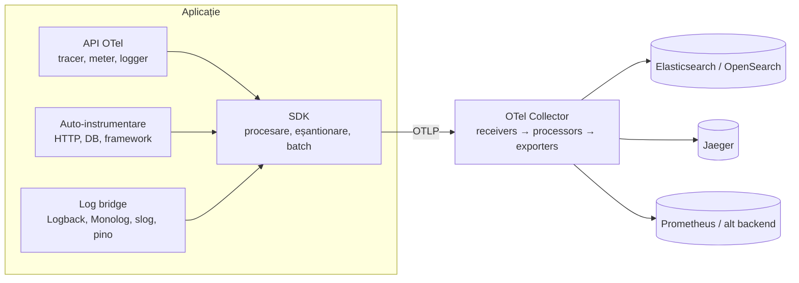

# 5. OpenTelemetry

<!-- cuprins -->
**Cuprins**

- [5.1 Componente](#51-componente)
- [5.2 Resursa (Resource)](#52-resursa-resource)
- [5.3 Modelul de date al unui log (Logs Data Model)](#53-modelul-de-date-al-unui-log-logs-data-model)
- [5.4 Collectorul](#54-collectorul)
- [5.5 Propagarea contextului](#55-propagarea-contextului)
- [5.6 Convenții semantice (semconv)](#56-convenții-semantice-semconv)
- [5.7 Cum e folosit în proiect](#57-cum-e-folosit-în-proiect)
<!-- /cuprins -->

**OpenTelemetry (OTel)** este un standard deschis (proiect CNCF, din unirea OpenTracing + OpenCensus) pentru
**producerea, colectarea și transportul** datelor de telemetrie — traces, metrics și logs — **independent de
backend**. OTel nu stochează și nu afișează nimic: el produce datele și le duce unde vrei
(Elasticsearch, OpenSearch, Jaeger, Grafana, un vendor comercial).

Avantajul: instrumentezi codul **o singură dată**, apoi schimbi backend-ul doar din configurare.

## 5.1 Componente



| Componentă | Ce face |
|------------|---------|
| **API** | interfețele folosite în cod: `tracer.startSpan()`, `meter.createCounter()`, logger |
| **SDK** | implementarea: resursă, eșantionare, procesare în batch, exportatori |
| **Auto-instrumentare** | biblioteci care creează span-uri automat pentru HTTP, baze de date, cozi (fără cod) |
| **Log bridge** | conectează loggerul existent (Logback, Monolog, Python `logging`, `ILogger`, slog, pino) la OTel |
| **OTLP** | protocolul de transport (gRPC :4317 sau HTTP/protobuf :4318) |
| **Collector** | proces separat care primește, procesează și trimite telemetria |
| **Convenții semantice** | nume standard pentru atribute (`http.request.method`, `service.name`) |

## 5.2 Resursa (Resource)

Atribute care descriu **sursa** telemetriei, atașate automat la fiecare span / metrică / log:

| Atribut | Exemplu |
|---------|---------|
| `service.name` | `go-otel-api` |
| `service.namespace` | `demo` |
| `service.version` | `1.0.0` |
| `service.instance.id` | `laravel-1` |
| `deployment.environment.name` | `local` (înlocuiește vechiul `deployment.environment`) |
| `telemetry.sdk.language` | `go` |

Se setează din cod sau prin variabile standard: `OTEL_SERVICE_NAME`, `OTEL_RESOURCE_ATTRIBUTES`.

## 5.3 Modelul de date al unui log (Logs Data Model)

| Câmp | Descriere |
|------|-----------|
| Timestamp | momentul evenimentului |
| ObservedTimestamp | momentul în care a fost observat (preluat) |
| TraceId / SpanId | trace-ul și span-ul activ când s-a scris logul |
| TraceFlags | flag-ul W3C (eșantionat) |
| SeverityText / SeverityNumber | nivelul (text) și valoarea numerică 1–24 |
| Body | mesajul (text sau structură) |
| Resource | sursa (serviciu, versiune, mediu) |
| InstrumentationScope | cine a emis — pentru loguri, numele loggerului |
| Attributes | câmpuri suplimentare ale evenimentului |
| EventName | tipul evenimentului (pentru loguri-eveniment) |

SeverityNumber pe intervale: 1–4 TRACE, 5–8 DEBUG, 9–12 INFO, 13–16 WARN, 17–20 ERROR, 21–24 FATAL.

Sursa: <https://opentelemetry.io/docs/concepts/signals/logs/>

## 5.4 Collectorul

Un pipeline configurabil în YAML:

```yaml
receivers:   { otlp: { protocols: { grpc: {}, http: {} } } }   # de unde vin datele
processors:  { batch: {}, transform: { ... }, filter: { ... } } # ce faci cu ele
exporters:   { elasticsearch: { ... }, otlp/jaeger: { ... } }   # unde le trimiți
service:
  pipelines:
    logs:    { receivers: [otlp], processors: [batch, transform], exporters: [elasticsearch] }
    traces:  { receivers: [otlp], processors: [batch], exporters: [otlp/jaeger] }
```

- **receivers**: OTLP, Prometheus, fișiere (`filelog`), syslog, Kafka…
- **processors**: `batch`, `memory_limiter`, `transform` (limbajul **OTTL**), `filter`, `attributes`,
  `resource`, `tail_sampling`…
- **exporters**: `elasticsearch`, `opensearch`, `otlp`, `prometheusremotewrite`, `kafka`, `debug`…
- **connectors**: leagă pipeline-uri (de ex. din traces se calculează metrici).

Moduri de rulare: **agent** (lângă aplicație / pe nod) și **gateway** (central). Distribuții: *core*,
*contrib* (toate componentele comunității), plus distribuții de vendor (de ex. **EDOT** — Elastic
Distribution of OpenTelemetry, folosită în proiect).

## 5.5 Propagarea contextului

- **W3C Trace Context** (`traceparent`, `tracestate`) — duce `trace_id` + span-ul părinte între servicii;
- **W3C Baggage** (`baggage`) — duce perechi cheie-valoare (`request.id`, `user.id`);
- auto-instrumentarea clienților HTTP le injectează, cea a serverelor le extrage — cererea rămâne
  un singur trace chiar și printr-o coadă de joburi (contextul se pune în payload-ul jobului).

## 5.6 Convenții semantice (semconv)

Nume comune ca toate limbajele să producă aceleași câmpuri: `http.request.method`,
`http.response.status_code`, `http.route`, `url.path`, `client.address`, `user.id`, `server.port`,
`exception.type`… Folosește convențiile **stabile** (de ex. Python vechi scria `http.method` /
`http.status_code`; se trece la cele noi cu `OTEL_SEMCONV_STABILITY_OPT_IN=http`).

## 5.7 Cum e folosit în proiect

| Serviciu | Traces | Logs (bridge) |
|----------|--------|---------------|
| Spring Boot | starter OTel Spring Boot | Logback appender (MDC → atribute) |
| Laravel | auto-instrumentare PHP + contrib Laravel | Monolog → OTel |
| Django | `opentelemetry-instrument` | `logging` Python → OTel |
| ASP.NET Core | OpenTelemetry .NET | `ILogger` → OTel (scope-uri → atribute) |
| Go | otelhttp | `otelslog` (slog → OTel) |
| Node / Express | auto-instrumentations-node | instrumentation-pino |

Toate trimit OTLP la collectorul EDOT (`:4328`), care aplică standardul: loguri → Elasticsearch,
traces → Jaeger, metrici → aruncate.

<!-- nav -->
---
[← 4. Unde se propagă și se salvează Trace ID-ul](04-propagarea-trace-id.md) · [Cuprins](README.md) · [6. ELK și OpenSearch →](06-elk-opensearch.md)
<!-- /nav -->
