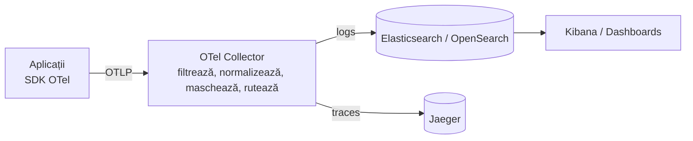

# Logging centralizat — pe scurt

**Cuprins:** [1. Concepte](#1-concepte) · [2. De ce centralizare](#2-de-ce-centralizare) ·
[3. Arhitectura](#3-arhitectura) · [4. Formatul logului](#4-formatul-logului) · [5. Niveluri](#5-niveluri) ·
[6. Indexuri](#6-indexuri) · [7. Trace ID](#7-trace-id) · [8. Domenii și instanțe](#8-domenii-și-instanțe) ·
[9. Securitate](#9-securitate) · [10. Retenție](#10-retenție) · [11. Checklist](#11-checklist) ·
[12. În proiect](#12-în-proiect)

## 1. Concepte

| | Ce este | Răspunde la | Unde se stochează |
|---|---------|-------------|-------------------|
| **Log** | un eveniment cu timp, nivel, mesaj și câmpuri | *ce s-a întâmplat?* | Elasticsearch / OpenSearch |
| **Trace** | drumul unei cereri prin servicii (arbore de span-uri) | *pe unde a trecut, unde a durat / a eșuat?* | Jaeger |
| **Metrică** | număr agregat în timp | *cât de des, cât de mult?* | Prometheus (în proiect: nu se stochează) |

- **OpenTelemetry (OTel)** — standard deschis care produce și transportă logs / traces / metrics (SDK, protocol OTLP, Collector), independent de backend.
- **ELK** (Elasticsearch + Logstash + Kibana) / **OpenSearch** (fork Apache 2.0) — stochează, indexează și caută logurile.
- Legătura dintre log și trace: același **`trace_id`**.

## 2. De ce centralizare

Multe servicii × multe instanțe × containere care dispar = logurile locale se pierd și nu pot fi căutate
sau corelate. Centralizat ai: **un loc** de căutare, **un format**, corelare după `trace_id`, alerte,
retenție și acces controlat, fără SSH în producție.

## 3. Arhitectura



- aplicațiile **nu** scriu direct în stocare — trec prin **collector** (un singur set de reguli, schimbi backend-ul din config);
- aplicații vechi: stdout / fișiere → agent (Fluent Bit, Filebeat, `filelog`) → același collector;
- standardul se impune **la sursă** (SDK, middleware) **și în collector** (plasă de siguranță).

## 4. Formatul logului

Un document JSON plat, aceleași chei în toate limbajele:

```json
{
  "timestamp": "2026-10-12T09:15:02.123456Z",
  "level": "INFO",
  "logger": "app.go-otel",
  "service": "go-otel-api",
  "environment": "prod",
  "message": "request completed",
  "trace_id": "4bf92f3577b34da6a3ce929d0e0e4736",
  "span_id": "00f067aa0ba902b7",
  "context": { "userId": "1", "username": "Demo User", "ipAddress": "10.0.0.7" },
  "request": { "method": "POST", "url": "/api/login", "body": { "user": "demo", "password": "******" } },
  "response": { "statusCode": 200 }
}
```

- **obligatorii:** `timestamp` (UTC, ISO 8601), `level`, `service`, `environment`, `message`;
- **opționale, doar dacă au valoare:** `logger`, `trace_id`, `span_id`, `context`, `request`, `response`, `tags`;
- `context.sub` doar pentru JWT de acces OAuth2; `request`/`response` doar pe logul „request completed";
- **nu se pun:** durată, user agent, header-e, request id (sunt în trace), `host.*`, `process.*`, zgomot de framework.

## 5. Niveluri

Log4j: `TRACE` < `DEBUG` < `INFO` < `WARN` < `ERROR` < `FATAL`.

- în stocarea centrală ajung **doar `INFO`, `WARN`, `ERROR`, `FATAL`**;
- `TRACE` / `DEBUG` rămân locale (dezvoltare) — collectorul le aruncă;
- `WARN` = eroare a clientului (4xx), `ERROR` = eroare a serverului (5xx).

## 6. Indexuri

Format: **`[app-name]-[data]`** = `<service.name>-YYYY.MM.DD` (ziua UTC a logului):

```
spring-otel-api-2026.10.12
laravel-otel-worker-2026.10.12
```

- un **index template** comun dă tipurile (`timestamp` = date, `message` = text, restul = keyword);
- un **data view** în Kibana peste toate indexurile; filtrezi cu `service:`, `level:`, `trace_id:`;
- index zilnic → retenție simplă (ștergi zilele vechi); 1 shard / index la aplicații mici.

## 7. Trace ID

Se propagă și se salvează în 4 locuri:

| Unde | Cum |
|------|-----|
| **între servicii** | header W3C `traceparent: 00-<trace_id>-<span_id>-01`; în Kafka/RabbitMQ în **headers**, nu în body; în gRPC în metadata |
| **în loguri** | contextul de logare (MDC, scope-uri, `withContext`) → câmpurile `trace_id`, `span_id` |
| **în răspuns** | `X-Trace-Id: <trace_id>` → utilizatorul raportează codul, suportul îl caută în Kibana / Jaeger |
| **în DB** (audit, erori, tranzacții) | coloană `trace_id VARCHAR(32)` indexată |

Nu se face manual: auto-instrumentarea OTel injectează și extrage contextul. Manual rămân doar
`X-Trace-Id` și coloana din DB.

## 8. Domenii și instanțe

Pot exista mai multe domenii (de ex. **SFS, MF, CTIF, Vamă**), niciunul obligatoriu, fiecare cu
aplicații în mai multe instanțe. Identitatea vine din resursa OTel, setată prin variabile de mediu:

```bash
OTEL_SERVICE_NAME=sfs-declaratii-api
OTEL_RESOURCE_ATTRIBUTES=service.namespace=sfs,service.instance.id=$HOSTNAME,deployment.environment.name=prod
```

- index: `sfs-declaratii-api-2026.10.12` → acces, retenție și cote pe tiparul `sfs-*`, `vama-*`;
- un domeniu nou = doar configurare; unul lipsă nu strică nimic;
- `service.instance.id` arată care replică a procesat cererea; `trace_id` leagă cererea și între domenii.

## 9. Securitate

- secretele (`password`, `token`, `secret`, `access_token`) devin `"******"` **înainte** de stocare;
- date personale: minimul necesar (`userId`, nu email / CNP);
- TLS pe drum, autentificare și roluri pe indexuri (fiecare echipă / domeniu vede doar ale lui);
- corpuri doar JSON, maxim 4 KB.

## 10. Checklist

1. Scrie **formatul** (chei, niveluri, ce nu se loghează) înainte de cod.
2. **SDK OTel** + bridge de log în fiecare serviciu; middleware care pune contextul și scrie „request completed".
3. **Collector**: OTLP in, filtru DEBUG, normalizare, mascare, index `[app-name]-[data]`, `batch` + retry.
4. **Stocare**: index template, politică de retenție, roluri.
5. **Kibana**: data view, căutări salvate, alerte (rata de `ERROR`, 5xx, 401 în rafală, tăcere).
6. **Teste automate** pe format pentru fiecare serviciu.

## 11. În proiect

| Ce | Unde |
|----|------|
| 6 servicii (Spring, Laravel, Django, .NET, Go, Node) | `./start-all.sh` |
| Collector (format, filtru DEBUG, mascare, index) | `spring-otel/elk/otel-collector.yaml` |
| Index template + data view `logs` | `spring-otel/elk/kibana-setup.sh` |
| Kibana / Jaeger | <http://localhost:5601> / <http://localhost:16686> |
| Ștergere date | `./purge-all.sh` |
| Teste | `cd e2e && npx playwright test` |

Detalii pe capitole: [README.md](README.md).
